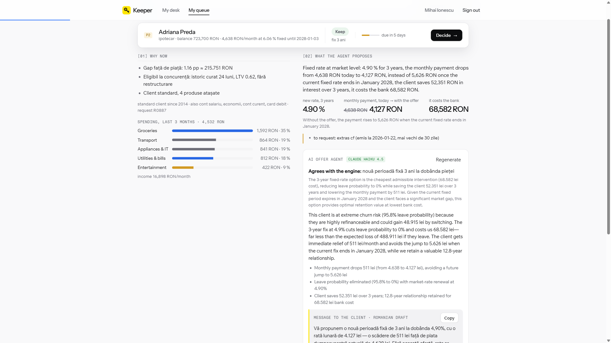
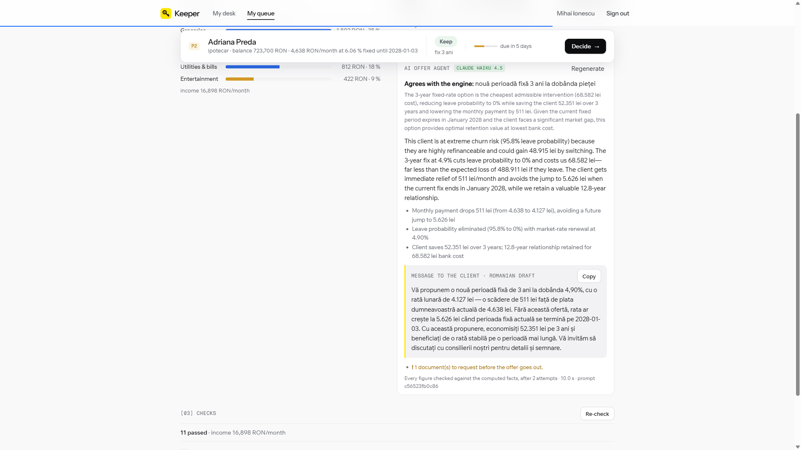
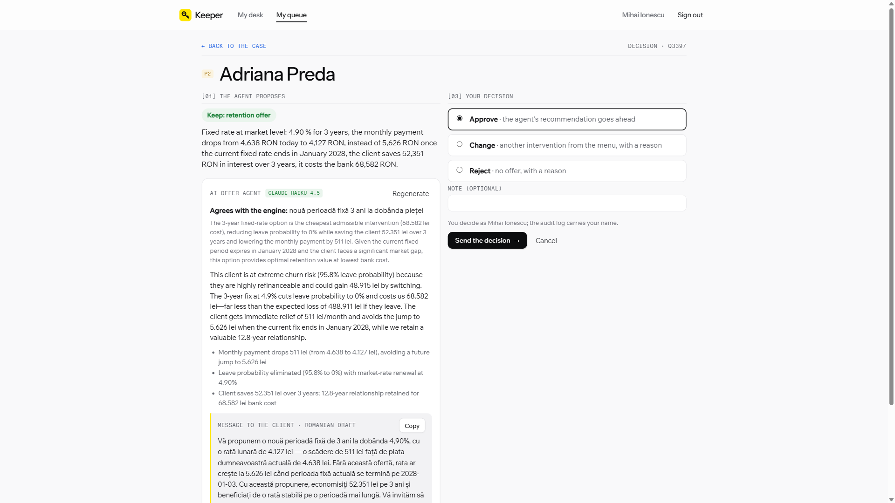
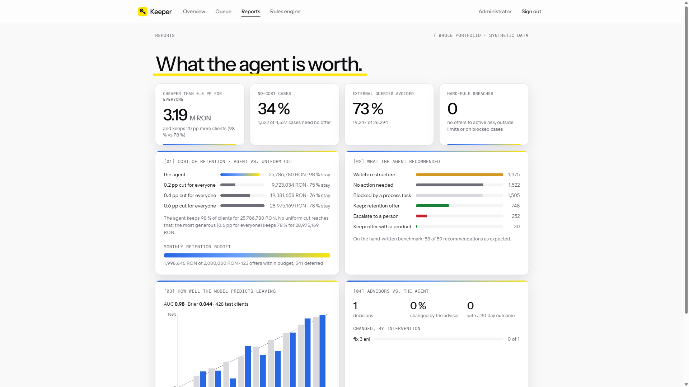

# Keeper

**Every client gets a banker who notices.**

Keeper is an AI colleague for retail credit advisors. Every morning it finds the clients who are about to leave,
runs only the checks that matter, and proposes the cheapest offer that keeps them, inside BNR limits and the
bank's budget. An AI agent writes the reasoning for the advisor and the message for the client. The advisor
decides with one click, and every decision lands in an audit log.

Built at the NEXXT hackathon for the Raiffeisen challenge *AI for Operational Efficiency*.
All data is synthetic: 10,000 generated clients, seed 42.



---

## The problem

**Meet Michael.** He opened his first account at his bank when he was 20. Thirteen years later the bank has his
salary, his savings and a mortgage of over 720,000 lei. He is still filed as a "standard" client.

His fixed rate ends in January 2028, and then his payment jumps from 4,638 to 5,626 lei a month. Other banks lend
at 4.90 %. One evening he opens the bank's app and simulates paying off his mortgage early. The bank sees it and
says nothing. A week later another bank's ad shows up, and he leaves, with his salary and savings.

**Why this happens.** Two habits in retail banking, as we understand them from the challenge brief and mentors:

- **Advisors are told to keep the most profitable clients.** Today's profit decides who gets a call, so young
  clients with long mortgages are invisible, even though they are worth the most over the years ahead.
- **When someone does leave, the answer is the same discount for everyone.** It is expensive, and it still misses
  the clients who need something different, or nothing at all.

**What our data shows** (measured on the synthetic portfolio, not on bank data):

- A uniform 0.6 pp rate cut for every client at risk keeps only **78 %** of them.
- **34 %** of the cases in the queue need no offer at all. A blanket discount spends money on them anyway.
- Running every check on every case would mean **26,294** external queries (tax authority, credit bureau, central
  credit register). Most of them are not needed for the decision.

The bank isn't blind. It's busy.

## Our idea

1. **Rank by what a client is worth over the years ahead, not by today's profit.** Value counts the margin on the
   balance for every year left on the loan, plus the products the client holds. A 33-year-old with a new mortgage
   ranks high.
2. **Pay only what it takes.** For each client Keeper prices a menu of 12 interventions and picks the cheapest one
   that brings the chance of leaving under 20 %, as long as it costs less than what the bank would lose.
3. **Sometimes the smartest offer is no offer.** If the client isn't leaving, Keeper says so and saves the discount.
4. **The rules decide what is allowed; the AI decides and explains within that; the human decides in the end.**

## See it in 60 seconds: case Q3397

This is Michael's case in the app (the synthetic client is named Adriana Preda; the advisor is Mihai Ionescu).

| What Keeper found | Figure |
|---|---|
| Signals | early-repayment simulation in the app, market gap 1.16 pp, eligible elsewhere, large balance |
| Chance of leaving | 95.8 % |
| Value of the client over the remaining loan | about 510,000 lei |
| Checks run | 11, all passed, 0 paid external queries |
| Cheapest offer that keeps the client | fixed rate 4.90 % for 3 years |
| Monthly payment | 4,638 lei today, 4,127 lei with the offer |
| Without the offer, from January 2028 | 5,626 lei |
| Cost to the bank | 68,582 lei, against an expected loss of about 489,000 lei |

The AI offer agent agrees with the engine, explains why, and drafts the message to the client in Romanian.
The advisor approves it and the decision goes to the audit log.

| AI offer agent | Advisor decision |
|---|---|
|  |  |

## How the agent works

```
 portfolio + client requests
        │
        ▼
 1. Signals ── 24 signals: departure, credit risk, process blocks
        │
        ▼
 2. Queue ── priority = chance of leaving × future value × can we act; bands P1 / P2 / P3
        │
        ▼
 3. Checks ── chosen by products held + reason; 6 stages, stop at the first failure
        │
        ▼
 4. Retention model ── 12 interventions, hard limits first, then the cheapest that keeps the client
        │
        ▼
 5. AI offer agent ── picks among the allowed offers, writes the argument and the client message
        │
        ▼
 6. Advisor ── approve / change / reject with a reason → offer, schedule, documents, audit log
```

1. **Signals.** 24 signals in three families: about to leave (fixed rate expiring, market gap in lei, balance
   certificate request, payments to another lender, salary moved, app simulations), credit risk (new arrears,
   falling income, card stress, garnishment) and process blocks (expired ID, missing consent). Salary, pension
   and payments to other lenders are inferred from transactions, not from labels.
2. **Queue.** Priority combines the chance of leaving, the client's future value and whether the bank can act.
   Credit risk is a separate channel: a client in arrears gets restructuring, never a retention discount.
   P1 / P2 / P3 have deadlines of 1, 5 and 20 days.
3. **Checks.** 18 checks across six stages: in-house, tax authority (ANAF), credit bureau, central credit register,
   collateral and eligibility. Keeper picks them from what the client holds and why the case exists, shows the
   plan before running it, and stops at the first failure. That is where the 73 % of avoided external queries
   come from.
4. **Retention model.** For each case: what the client gains by leaving (over 3 years), the chance of leaving
   (a trained logistic model), and the client's value if they stay. Hard limits remove options first:
   - debt-to-income 40 %, or 20 % for foreign-currency loans
   - loan-to-value 0.85
   - age 70 at maturity
   - minimum margin 1.5 pp
   - a retention budget per client tier
   - a monthly portfolio budget of 2 million lei

   Then the cheapest remaining intervention that brings the chance of leaving under 20 % wins.
   The result is one of six outcomes: no action, retention offer, offer with a product, restructure,
   escalate, or blocked.
5. **AI offer agent.** A language model (Claude Haiku 4.5 on Amazon Bedrock in our demo) receives only computed
   facts and the list of allowed offers. It chooses one, explains the choice to the advisor in English and writes
   the client message in Romanian.
6. **Advisor.** Approve, change to another feasible offer, or reject. Changing or rejecting requires a reason.
   After 90 days the advisor records whether the client stayed; that outcome becomes a real training label.

### Guardrails

- **The AI can only choose what the rules allow.** Its choice is a fixed list of offers the engine already
  approved; blocked, escalated and credit-risk cases get an explanation, not an offer.
- **No personal data goes to the model.** No names, and no free text from the data, so there is no
  prompt-injection path.
- **Every number is checked.** Each figure in the AI's text must exist in the computed facts. The client
  message may only quote the loan and the chosen offer, never the bank's cost or internal scores. Competitor
  names and promises like "guaranteed" or "free" are rejected.
- **One retry, then a safe fallback.** A rejected answer gets one retry with the reasons; after that Keeper uses
  a deterministic template, clearly labelled. Without an API key the whole app still works on the template.
- **The human decides, and everything is traceable.** Every decision stores the advisor, the reason, the AI
  proposal, and the version of the rules, the model and the prompt.
- **Missing data slows a case down; it doesn't break the flow.** If a source is unavailable, the case carries an
  uncertainty, the offer becomes conditional, and critical cases go to a person.

## What works today

- [x] Ranked daily queue from 24 signals, with bands, deadlines and search
- [x] 18 checks in 6 stages, chosen per case, with a live re-check
- [x] Retention model with a 12-intervention menu, hard limits and a monthly budget
- [x] Trained churn model with calibration, plus a formula fallback
- [x] AI offer agent with validation, retry, template fallback and three providers (Anthropic, Bedrock, OpenAI)
- [x] Advisor accounts and an administrator role, enforced on the server
- [x] Decisions with reasons, an audit log, 90-day outcomes and a feedback report
- [x] Rules engine: every rule, threshold and the AI prompt are YAML, validated on save
- [x] Reports: savings, no-offer cases, avoided queries, hard-rule breaches, model calibration
- [x] 10 "unexpected situation" scenarios: foreign currency, co-borrower, unavailable source, duplicates and more
- [x] Docker setup, 243 automated tests

**Simulated, not real:** the tax authority, credit bureau, central credit register and collateral checks are local
mocks with consistent data. Retraining from real 90-day outcomes is wired in but needs at least 200 real outcomes.

## Results

On the full synthetic portfolio of 10,000 clients (6,032 cases, 2,150 retention candidates):

| Figure | Keeper | Same discount for everyone |
|---|---|---|
| Clients kept | **98 %** (2,105 of 2,150) | 78 % with a 0.6 pp cut |
| Retention cost | **25.79 M lei** | 28.98 M lei |
| Difference | **3.19 M lei less, and 20 pp more clients kept** | |

| Operational efficiency | Value |
|---|---|
| Cases that need no offer | 34 % (1,522 of 4,527) |
| External queries avoided | 73 % (19,247 of 26,294) |
| Hard-rule breaches (offers to clients at risk, outside limits, on blocked cases) | 0 |
| Benchmark: 60 hand-written scenarios, recommendation as expected | 58 of 59 |
| Signal detection on all 10,000 clients (F1) | 1.00 |



**How a bank would pilot it:** one portfolio, one team of advisors, three months. The advisors' recorded 90-day
outcomes replace our simulated behaviour as the ground truth, and the churn model is retrained on them.

## Architecture

- **Python engine** (`retailagent/`): pure functions per step, deterministic from seed 42, one pipeline.
- **FastAPI** (`retailagent/api.py`): sessions, roles, decisions, the AI agent endpoint and the rules engine.
- **React + TypeScript UI** (`ui/`): advisor desk, queue, case, decision, reports and rules engine.
- **Configuration, not code** (`config/*.yaml`): signals, priorities, checks, limits, the intervention menu, the
  team and the AI prompt. Each file is validated with pydantic on load and on save in the rules engine.
- **Versioned decisions:** every recommendation and audit row carries a hash of the config, the model version,
  the prompt hash and the code commit.
- **Pluggable AI provider:** Anthropic, Amazon Bedrock or OpenAI, chosen in `config/llm.yaml` or the environment;
  keys only in `.env`, which git and Docker ignore.

```
retailagent/   engine: signals, queue, checks, retention, recommend, approve, llm, api
config/        the rules, as validated YAML (8 files)
models/        trained churn model + its metrics and calibration
ui/            React interface (Keeper)
tests/         243 tests
docs/          technical reference, rule sources, screenshots
```

## Run it

**Docker** (no local Python or Node needed):

```bash
docker compose up --build        # UI http://localhost:8080 · API http://localhost:8000/docs
```

**Local, API + UI:**

```bash
pip install -r requirements.txt
python -m retailagent.generate   # 10,000 synthetic clients (~30 s)
python -m retailagent.api        # runs the whole flow at start-up (~3–4 min), then serves on :8000
cd ui && npm install && npm run dev   # http://localhost:5173
```

**Python only:** `python -m retailagent.pipeline` writes `out/demo.html`, a static page with the queue and cases.

**Demo accounts:** advisors Ana Pop, Mihai Ionescu, Ioana Dumitru and Radu Stan, password `1234`.
Administrator, password `admin` (set `RETAILAGENT_ADMIN_PAROLA` to change it).

**Turn on the AI agent:** copy `.env.example` to `.env` and fill in one provider key. Check it with
`python -m retailagent.llm --verifica`. Without a key, Keeper uses the deterministic template.

**Tests:** `python -m pytest`

## Limitations and what we would validate next

- **The data is synthetic.** Client behaviour, including who leaves after which offer, is simulated by our own
  generator. The 98 % vs 78 % comparison shows the logic works as designed, not what a real portfolio would do.
- **The churn model's AUC of 0.98 is circular.** It learns the rules we used to generate the data. Its real value
  starts when the labels come from advisors' 90-day outcomes.
- **Thresholds need calibration with the bank:** the 20 % target, the tier budgets, the weights and the menu.
- **Keeper drafts, it doesn't send.** There is no channel to the client yet; the advisor copies the message or calls.
- **The AI validator checks numbers, not meaning.** It guarantees every figure exists in the facts, not that it is
  used in the right sentence. That is why the advisor reads the text before sending.
- **Most offers wait for next month's budget.** Under the 2 million lei monthly cap, 123 offers fit and 541 are
  deferred. The cap orders offers by value kept per lei, so the budget goes where it keeps the most.

## Learn more

- [`docs/ARCHITECTURE.md`](docs/ARCHITECTURE.md): the full technical reference (in Romanian): every command, the API,
  the model step by step, the data, unexpected situations and the interpretations to validate.
- [`docs/REGULI.md`](docs/REGULI.md): every rule with its source (BNR, OUG 50, KYC/AML, internal policy, model).
- [`MODEL_FINAL.md`](MODEL_FINAL.md): the product reference we built against.
- [`AUDIT.md`](AUDIT.md): our pre-hand-in audit and what we fixed after it.
